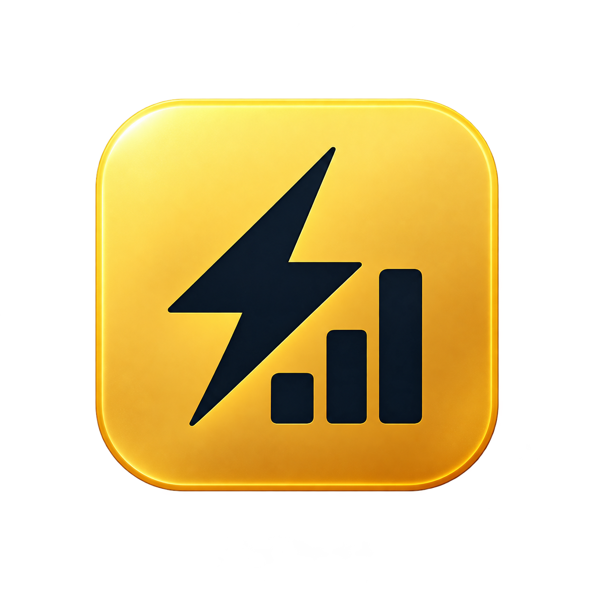
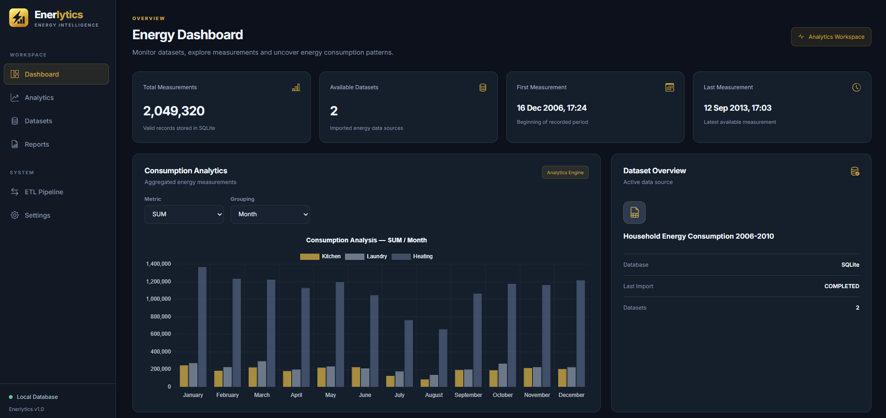
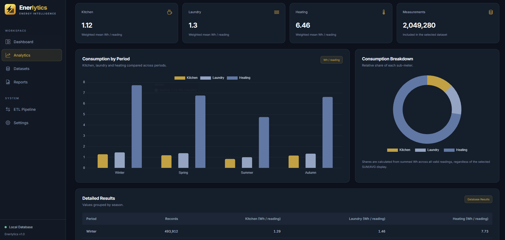
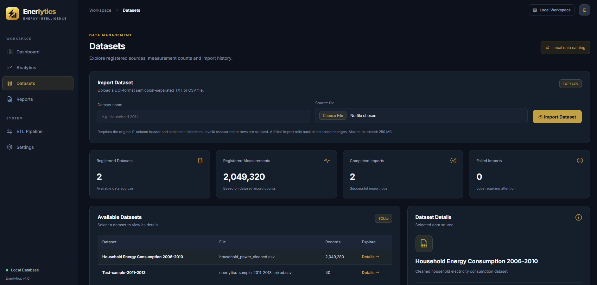
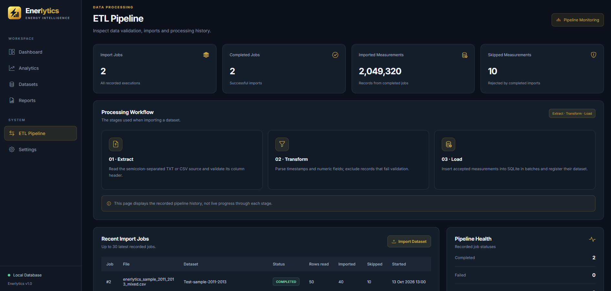
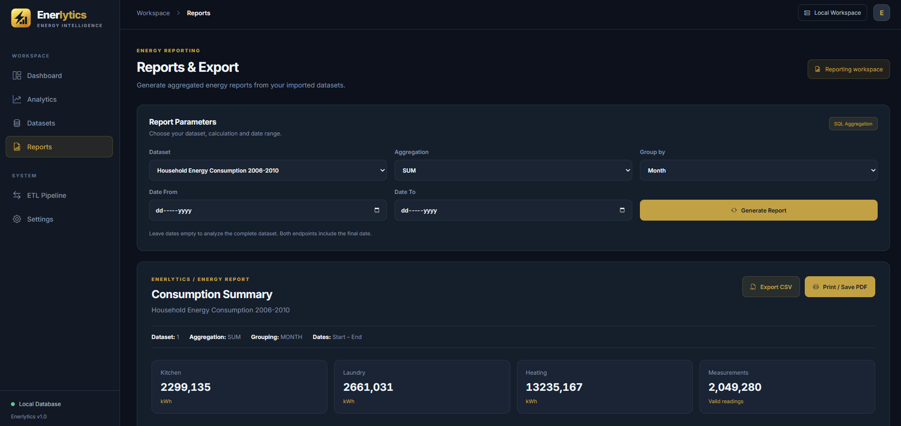
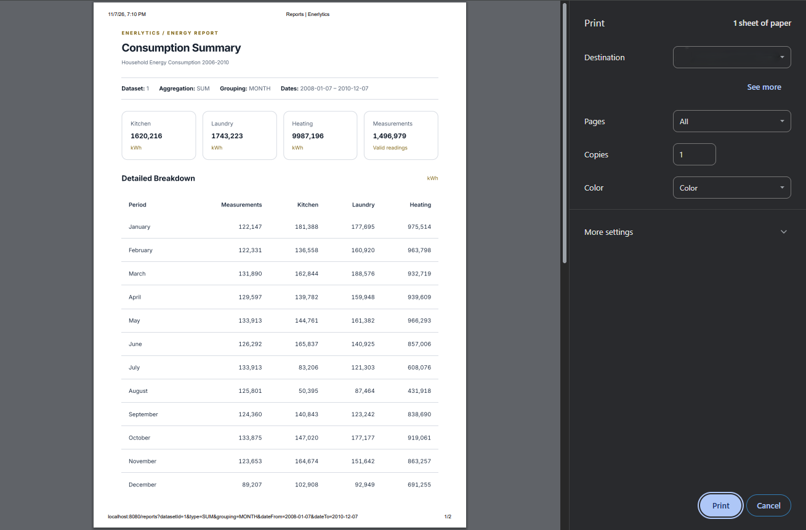
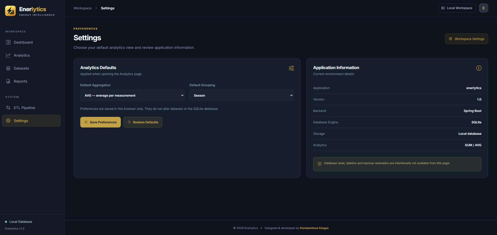

<div align="center">



# Enerlytics

### Energy Consumption Analytics & ETL Platform

**Explore energy data. Understand consumption. Turn measurements into insights.**

<p>
  
  
  
  
  
  
</p>

A locally hosted platform for exploring household electricity data, processing large datasets, visualizing consumption patterns, and exporting analytical reports.

[Overview](#overview) · [Features](#core-features) · [Screenshots](#application-screenshots) · [Getting Started](#getting-started) · [Author](#author)

</div>

---

## Overview

**Enerlytics** is a full-stack energy analytics application that transforms a university energy-processing exercise into a multi-page web platform. It provides tools to import and validate household electricity measurements, examine consumption trends, group observations by time period, compare date ranges, and generate reports.

The application is designed for **local or trusted environments**, with SQLite storage and a responsive user interface built using reusable Thymeleaf fragments.

## Core Features

| Module | Capabilities |
| --- | --- |
| **Dashboard** | Dataset and measurement overview, available date range, and energy-consumption visualizations. |
| **Analytics** | SUM and AVG aggregations for the three sub-metering channels, grouped by month, season, weekday, or time of day. |
| **Date Comparisons** | Date-range filtering and side-by-side analysis of two selected periods using charts. |
| **Datasets** | Dataset registration, inspection, TXT/CSV upload, and import history. |
| **ETL Pipeline** | Import workflow monitoring, job statuses, imported/skipped row counts, and failure details. |
| **Reports** | Filtered results, CSV downloads, and browser-based printing or saving as PDF. |
| **Settings** | Browser-local preferences for the analytics experience. |
| **Responsive UI** | Navy-and-gold design, reusable layouts, and Chart.js-based visualizations. |

## Data Processing & Analytics

Enerlytics supports the **UCI Individual Household Electric Power Consumption** dataset, covering observations from December 2006 to November 2010. The original dataset contains approximately **2,049,280 records**.

### Supported Measurements

- Global active and reactive power
- Voltage and global intensity
- Sub-metering 1 — Kitchen
- Sub-metering 2 — Laundry
- Sub-metering 3 — Water heater / air conditioning

The three sub-metering channels record **Wh per measurement interval**. Their `SUM` aggregation adds the readings (converted to kWh when displayed as such); `AVG` represents Wh per valid observation.

**Important:** Grouping by month, season, or weekday combines observations across years unless a date filter is active.

### Data Import & ETL

The web importer accepts UTF-8 `.txt` and `.csv` files with a **semicolon-separated** schema and the following exact header:

```text
Date;Time;Global_active_power;Global_reactive_power;Voltage;Global_intensity;Sub_metering_1;Sub_metering_2;Sub_metering_3
```

Dates use `d/M/yyyy` and times use `HH:mm:ss`. Invalid rows may be skipped and logged; imports with no valid observations are rejected. Arbitrary CSV schemas are **not** automatically supported.

## Technology Stack

| Layer | Technologies |
| --- | --- |
| **Backend** | Java 21, Spring Boot 4.1.1, Spring MVC |
| **Frontend** | Thymeleaf, HTML5, CSS3, JavaScript, Chart.js |
| **Database** | SQLite |
| **Persistence & Loading** | Spring Data JPA, Hibernate, JDBC batch operations |
| **Build** | Maven, Maven Wrapper |
| **Testing** | JUnit, Spring Boot Test |

## Application Architecture

The application separates web controllers, analytics services, database repositories, import and ETL logic, and presentation templates.

```text
src/main/
├── java/com/kkargas/enerlytics/
│   ├── analytics/        # Aggregation and grouping logic
│   ├── controller/       # Web and API endpoints
│   ├── etl/              # Extraction, cleaning, loading and CLI runners
│   ├── importing/        # Parsers and import helpers
│   ├── model/            # Entities and energy measurements
│   ├── repository/       # Persistence repositories
│   └── service/          # Dataset import services
└── resources/
    ├── static/           # Stylesheets, scripts and images
    ├── templates/        # Thymeleaf views and shared fragments
    └── application.properties
```

## Application Screenshots

### Dashboard

Overview of available energy data and key consumption trends.



### Analytics

Interactive data exploration, aggregations and energy-consumption comparisons.



### Datasets

Dataset management and source-file imports.



### ETL Pipeline

Monitoring the extraction, validation and import processing workflow.



### Reports

Reviewing energy-consumption results and filtered report data.



### Report Export

Export options for analytical reports and results.



### Settings

Local application preferences.



## Getting Started

### Prerequisites

- **JDK 21** or newer
- Internet access during the initial Maven dependency download
- A compatible household electricity dataset to import

### 1. Clone the Repository

```bash
git clone https://github.com/KonKargas/Enerlytics.git
cd Enerlytics
```

### 2. Run the Application

**Windows:**

```bat
mvnw.cmd spring-boot:run
```

**macOS / Linux:**

```bash
./mvnw spring-boot:run
```

Alternatively, with Maven installed:

```bash
mvn spring-boot:run
```

### 3. Open Enerlytics

Navigate to **http://localhost:8080/dashboard**.

The application creates `enerlytics.db` in the current working directory if it does not exist. On a fresh installation, the database is empty until a compatible file is imported from **Datasets**.

### Example Import File

Create a file named `example.csv` containing:

```csv
Date;Time;Global_active_power;Global_reactive_power;Voltage;Global_intensity;Sub_metering_1;Sub_metering_2;Sub_metering_3
1/1/2011;12:00:00;1.5;0.1;230;6.5;1;2;3
1/1/2011;12:01:00;1.6;0.1;231;6.7;2;3;4
```

Upload it through **Datasets**. Back up your SQLite database before importing large datasets.

## Application Navigation

| Page | Route |
| --- | --- |
| Dashboard | `/dashboard` |
| Analytics | `/analytics` |
| Datasets | `/datasets` |
| ETL Pipeline | `/etl` |
| Reports | `/reports` |
| Settings | `/settings` |

## Testing

Run tests using Maven or your IDE:

```bash
./mvnw test
```

On Windows, use `mvnw.cmd test`.

**Test-data caveat:** Some tests depend on a developer's previously populated SQLite database rather than a clean fixture:

- `AggregationServiceTest` expects dataset ID `1` containing `2,049,280` rows.
- `EnergyMeasurementReadTest` expects the initial historical reading from `2006-12-16 17:24`.

These tests may fail in a fresh checkout with an empty database. Self-contained aggregation, filtering, and ETL/parser tests are more suitable for initial verification.

## Dataset Source & Repository Scope

- Primary data source: [UCI — Individual Household Electric Power Consumption](https://archive.ics.uci.edu/dataset/235/individual+household+electric+power+consumption)
- Large original and generated data files are **not included** in this repository.
- Optional CLI ETL runners are disabled by default and expect source files under `src/main/resources/data/` when enabled.
- The web upload workflow does not require these command-line runners.

## Notes & Limitations

- **Local use:** No application-level authentication or authorization is included. Do not expose an unrestricted instance to the public Internet.
- **Settings:** Browser preferences are stored in local storage, not SQLite.
- **PDF reports:** Saving as PDF uses the browser's print functionality; server-side PDF generation is not implemented.
- **Data protection:** Do not commit populated SQLite databases, generated ETL files, or restricted datasets to version control.
- **CSV compatibility:** The importer requires the documented column names and formats.

---

## Author

**Konstantinos Kargas**  
Full-Stack Software Engineer

- Website: [kkargas.com](https://kkargas.com)
- GitHub: [KonKargas](https://github.com/KonKargas)

---

*Enerlytics — transforming household energy measurements into meaningful analytics, insights, and reports.*
